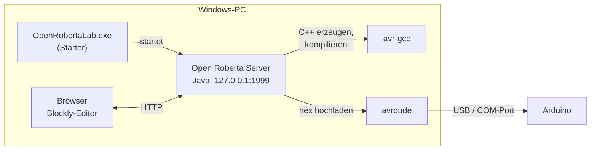

# Open Roberta Lab – lokal für Windows

[](https://github.com/marvinramm/openroberta-lab-local/actions/workflows/windows_installer.yml)

Das [Open Roberta Lab](https://lab.open-roberta.org) als **ein Programm für Windows**: Doppelklick, Browser geht auf, Arduino per USB anstecken,
COM-Port wählen, Programm mit Blöcken bauen, ▶ drücken – fertig.

- **Kein Internet nötig.** Server, Compiler und Upload laufen auf dem eigenen PC.
- **Kein externer Server, kein Connector-Programm, kein Token.**
- **Keine Admin-Rechte** für die Installation.
- Zusätzliche Bausteine für die **Arduino-Hardware im Unterricht**: Farbsensor **TCS34725** und **L293D-Motor-Shield**.

Unterstützte Boards: **Arduino Uno**, **Arduino Nano** (neuer und alter Bootloader), **Arduino Mega 2560**.

---

## Inhalt

- [Download und Installation](#download-und-installation)
- [Erste Schritte](#erste-schritte)
- [Der Farbsensor TCS34725](#der-farbsensor-tcs34725)
- [Das L293D-Motor-Shield](#das-l293d-motor-shield)
- [Pinbelegung auf einen Blick](#pinbelegung-auf-einen-blick)
- [Probleme lösen](#probleme-lösen)
- [Wie es funktioniert](#wie-es-funktioniert)
- [Selbst bauen und weiterentwickeln](#selbst-bauen-und-weiterentwickeln)
- [Herkunft und Lizenz](#herkunft-und-lizenz)

---

## Download und Installation

1. Unter **[Releases → neueste Version](https://github.com/marvinramm/openroberta-lab-local/releases/latest)** die Datei
   **`OpenRobertaLab-Setup.exe`** herunterladen (ca. 115 MB).
2. Setup starten. Windows SmartScreen warnt bei unsignierten Programmen:
   **„Weitere Informationen“ → „Trotzdem ausführen“**.
3. Installieren. Das Programm landet in `%LOCALAPPDATA%\Programs\OpenRobertaLab`,
   mit Verknüpfung auf dem Desktop und im Startmenü.

**Ohne Installation:** `OpenRobertaLab-portable.zip` aus demselben Release entpacken (z. B. auf einen USB-Stick) und
`OpenRobertaLab.exe` starten.

**Deinstallieren:** Windows-Einstellungen → Apps → „Open Roberta Lab“. Deine Programme in
`%LOCALAPPDATA%\OpenRobertaLab` bleiben dabei erhalten.

> Jeder Push auf `main` baut automatisch einen neuen Installer
> ([Actions → Windows-Installer](https://github.com/marvinramm/openroberta-lab-local/actions/workflows/windows_installer.yml)) und
> veröffentlicht ihn als neues Release. Von Hand geht es über **Run workflow**.

## Erste Schritte

1. **Open Roberta Lab** starten. Ein schwarzes Fenster öffnet sich – das ist der Server.
   Nach einigen Sekunden öffnet sich der Browser mit dem Lab (Arduino Uno ist schon ausgewählt).
2. **Arduino per USB anschließen.**
3. Im Lab **Roboter → Verbinden** und den COM-Port wählen, z. B. `USB-SERIAL CH340 (COM3)`.
   Ist nur ein Arduino angeschlossen, wird er automatisch gewählt; das Roboter-Symbol oben wird dann grün.
4. In **Roboterkonfiguration** die Bauteile eintragen (Sensoren, Motoren …).
5. Im **Programm** die Blöcke zusammenstecken und auf **▶** klicken.
   Das Programm wird kompiliert und hochgeladen. Oben erscheint „Das Programm wurde auf COM3 übertragen“.
6. Zum Beenden das **schwarze Fenster schließen**.

Andere Boards wählst du wie gewohnt über **Roboter → Roboter wechseln** (Uno, Nano, Mega).
Zum dauerhaften Speichern von Programmen unter **Anmelden → Registrieren** ein Benutzerkonto anlegen. Es liegt nur in
der lokalen Datenbank auf diesem PC; es wird nichts ins Internet übertragen.

| Was                         | Wo                                                     |
| --------------------------- | ------------------------------------------------------ |
| Programmdateien             | `%LOCALAPPDATA%\Programs\OpenRobertaLab`               |
| Datenbank (Programme, Nutzer) | `%LOCALAPPDATA%\OpenRobertaLab\db`                   |
| Server-Log                  | `%LOCALAPPDATA%\OpenRobertaLab\logs\server.log`        |
| Lab-Adresse                 | <http://127.0.0.1:1999> (nur vom eigenen PC erreichbar) |

## Der Farbsensor TCS34725

Neuer Sensor-Baustein für Uno, Nano und Mega. Er erkennt **Rot, Grün, Weiß und Schwarz** – ideal für Linienfolger,
Farbsortierer und Ampel-Spiele.

### Anschluss

| TCS34725 | Arduino Uno / Nano | Arduino Mega |
| -------- | ------------------ | ------------ |
| VIN      | 5V                 | 5V           |
| GND      | GND                | GND          |
| SDA      | **A4**             | 20 (SDA)     |
| SCL      | **A5**             | 21 (SCL)     |
| LED      | frei lassen (LED leuchtet) | frei lassen |

Der Konfigurationsblock zeigt immer SDA = A4 und SCL = A5 an; beim Mega gelten trotzdem die Pins 20 und 21.
A4 und A5 sind beim Uno und Nano die einzigen I²C-Pins. Hängt dort schon etwas anderes, das **kein** I²C-Gerät ist
(z. B. Trig/Echo eines Ultraschallsensors), meldet die Konfiguration einen Fehler. Den Ultraschallsensor dann einfach auf
**A0/A1** umstecken. Ein I²C-Display (LCD 1602 I²C, OLED) darf sich A4/A5 mit dem Farbsensor teilen.

### Konfiguration

Unter **Roboterkonfiguration → Sensoren → Farbsensor TCS34725**:

| Feld            | Standard | Bedeutung                                                           |
| --------------- | -------- | ------------------------------------------------------------------- |
| Name            | `F`      | Name, unter dem der Sensor im Programm erscheint                    |
| Schwarz unter % | `2`      | Ist die Helligkeit kleiner, meldet der Sensor **Schwarz**           |
| Weiß über %     | `12`     | Ist die Helligkeit größer (und keine Farbe dominiert), meldet er **Weiß** |

Es ist nur **ein** TCS34725 möglich (feste I²C-Adresse `0x29`).

### Programm

Der Block **„gib Farbe Farbsensor F“** hat fünf Modi:

| Modus   | Ergebnis                          | Typ   |
| ------- | --------------------------------- | ----- |
| Farbe   | Rot, Grün, Weiß, Schwarz oder Grau (= nicht erkannt) | Farbe |
| Licht   | Helligkeit in %                   | Zahl  |
| rot     | Anteil des Rot-Kanals am Licht in % | Zahl |
| grün    | Anteil des Grün-Kanals in %       | Zahl  |
| blau    | Anteil des Blau-Kanals in %       | Zahl  |

Im Modus **Farbe** vergleichst du das Ergebnis mit den Farbblöcken aus der Kategorie **Farben**
(Rot `#cc0000`, Grün `#33cc00`, Weiß `#ffffff`, Schwarz `#000000`):

```
wenn  [gib Farbe Farbsensor F]  =  [rot]
    mache  …
```

### Kalibrieren

Die Erkennung hängt von Abstand (ideal ca. 1 cm), Umgebungslicht und Oberfläche ab:

1. Ein kleines Programm bauen, das **Licht**, **rot**, **grün** und **blau** mit „zeige auf Serial Monitor“ ausgibt.
2. Den Sensor nacheinander über Schwarz, Weiß, Rot und Grün halten und die Werte notieren.
3. **Schwarz unter %** knapp über den Schwarz-Wert setzen, **Weiß über %** knapp unter den Weiß-Wert.

So entscheidet der Sensor im Modus Farbe:

1. Helligkeit unter „Schwarz unter %“ → **Schwarz**
2. Rot-Kanal mehr als 1,5-mal so stark wie Grün und Blau → **Rot**
3. Grün-Kanal mehr als 1,2-mal so stark wie Rot und Blau → **Grün**
4. Helligkeit über „Weiß über %“ → **Weiß**
5. sonst → **Grau** (nicht erkannt)

Der Treiber ist eine eigene, kleine Header-Datei
([`TCS34725.h`](RobotArdu/src/main/resources/arduino/TCS34725/TCS34725.h)) und braucht keine Adafruit-Bibliothek
(Integrationszeit 50 ms, Verstärkung 4×).

## Das L293D-Motor-Shield

Für das Adafruit Motor Shield der ersten Generation (L293D mit Schieberegister 74HC595) und Nachbauten.
In der **Roboterkonfiguration** (Kategorie Aktoren) pro Motor einen Block **L293D motor** mit Port **M1–M4** anlegen.
Im Programm (Kategorie Aktion) dreht **„run L293D motor … Geschwindigkeit … %“** den Motor:
−100 bis 100, negativ = rückwärts, 0 = Motor frei. Die Blöcke sind noch nicht ins Deutsche übersetzt.

## Pinbelegung auf einen Blick

Arduino Uno mit L293D-Shield, Farbsensor und Ultraschallsensor:

| Pin        | Belegt durch                                      |
| ---------- | ------------------------------------------------- |
| 0, 1       | USB / serielle Verbindung (nicht benutzen)        |
| 3, 5, 6, 11 | L293D: PWM der Motoren M2, M4, M3, M1            |
| 4, 7, 8, 12 | L293D: Schieberegister (Takt, Enable, Daten, Latch) |
| 9, 10      | Servo-Anschlüsse des Shields (Servo 2, Servo 1)   |
| A4, A5     | I²C: Farbsensor TCS34725 (SDA, SCL)               |
| **2, 13, A0–A3** | **frei** – z. B. Ultraschall Trig A0, Echo A1 |

## Probleme lösen

| Problem | Lösung |
| ------- | ------ |
| Kein COM-Port in der Liste | USB-Kabel prüfen (manche Kabel laden nur). Viele Nachbauten brauchen den Treiber **CH340** („CH340 Treiber Windows“ suchen). Im Geräte-Manager unter „Anschlüsse (COM & LPT)“ nachsehen. |
| „Übertragung fehlgeschlagen“ | Richtigen COM-Port gewählt? Serieller Monitor (z. B. der Arduino IDE) geschlossen? Andere Programme, die den Port benutzen, schließen und noch einmal ▶. |
| Nano lädt nicht | Wird automatisch mit neuem (115200 Baud) und altem Bootloader (57600 Baud) probiert. Sonst wie oben. |
| Fehler in der Roboterkonfiguration bei A4/A5 | Ein anderes Bauteil nutzt A4/A5 als normalen Pin. Auf A0–A3 umstecken. |
| Farbsensor meldet immer Grau | Kalibrieren (siehe oben); Abstand ca. 1 cm; Sensor-LED muss leuchten. |
| Browser öffnet sich nicht | Selbst <http://127.0.0.1:1999> aufrufen. |
| Fenster schließt sich mit Fehler | `%LOCALAPPDATA%\OpenRobertaLab\logs\server.log` ansehen. |
| „Das Lab läuft bereits“ | Es läuft schon ein schwarzes Fenster – dort weiterarbeiten oder es schließen. |

## Wie es funktioniert



- **`OpenRobertaLab.exe`** ([`launcher.c`](Resources/windowsStandalone/launcher.c)) legt beim ersten Start die
  Datenbank an, startet den Server mit der mitgelieferten Java-Laufzeit und öffnet den Browser. Wird das Fenster
  geschlossen, endet auch der Server.
- Der Server läuft im **lokalen Modus** (`server.local.serial=true`):
  - `GET /rest/local/ports` listet die COM-Ports des PCs,
  - **▶** kompiliert das Programm ohne Roboter-Token,
  - `POST /rest/local/upload` lädt die hex-Datei mit avrdude auf den gewählten Port.

  Diese Schnittstellen nehmen nur Anfragen vom eigenen PC und von Seiten dieses Servers an.
- Unter Windows wird ohne Bash kompiliert: `ArduinoAvrDirectBuild` ruft avr-g++, avr-gcc und avr-objcopy direkt auf.
- Auf einem normalen, öffentlichen Lab-Server ist der lokale Modus aus; dort funktioniert alles wie im Original
  (Token und Connector).

## Selbst bauen und weiterentwickeln

Voraussetzungen (Linux, z. B. Ubuntu): Java 11+, Maven, `gcc-mingw-w64-x86-64`, `nsis`, `zip`, `unzip`, `curl`.

```bash
mvn clean install -DskipTests
```

```bash
Resources/windowsStandalone/build-windows.sh target/windowsStandalone
```

Ergebnis: `target/windowsStandalone/OpenRobertaLab-Setup.exe` und `OpenRobertaLab-portable.zip`.
Das Skript lädt Temurin-JRE 11, avr-gcc 7.3, avrdude 7.3 und die Arduino-Ressourcen von GitHub und packt nur die
AVR-Boards ein.

### Wichtige Dateien

| Datei | Inhalt |
| ----- | ------ |
| [`Resources/windowsStandalone/`](Resources/windowsStandalone) | Starter, Build-Skript, Installer (NSIS), LIESMICH |
| [`.github/workflows/windows_installer.yml`](.github/workflows/windows_installer.yml) | baut und veröffentlicht den Installer |
| `OpenRobertaServer/…/restServices/local/LocalSerialController.java` | COM-Ports auflisten, Upload mit avrdude |
| `RobotArdu/…/worker/compile/ArduinoAvrDirectBuild.java` | Kompilieren ohne Bash (Windows) |
| `RobotArdu/…/syntax/sensors/arduino/tcs34725/` | Farbsensor-Block (Java) |
| `RobotArdu/src/main/resources/arduino/TCS34725/TCS34725.h` | Farbsensor-Treiber (C++) |
| `OpenRobertaWeb/src/app/roberta/controller/connections/connections.ts` | `LocalSerialOrTokenConnection` im Browser |

### Lab unter Linux im lokalen Modus starten

Praktisch zum Testen ohne Windows (avr-gcc und avrdude aus dem Paketmanager, Arduino-Ressourcen aus
[ora-cc-rsc](https://github.com/OpenRoberta/ora-cc-rsc) unter `<rsc>/RobotArdu/arduino-resources`):

```bash
java --add-opens java.base/java.lang=ALL-UNNAMED -Dora.arduino.directBuild=true -cp "OpenRobertaServer/target/resources/*" de.fhg.iais.roberta.main.ServerStarter -d database.mode=embedded -d database.parentdir=/tmp/ora-db -d database.name=openroberta-db -d server.staticresources.dir=OpenRobertaServer/staticResources -d robot.crosscompiler.resourcebase=<rsc> -d server.ip=127.0.0.1 -d server.local.serial=true
```

Die Datenbank vorher einmal anlegen:

```bash
java -cp "OpenRobertaServer/target/resources/*" de.fhg.iais.roberta.main.Administration create-empty-db jdbc:hsqldb:file:/tmp/ora-db/openroberta-db
```

Das Frontend (TypeScript) wird mit `npm ci && npx gulp` in `OpenRobertaWeb/` gebaut; die erzeugten Dateien unter
`OpenRobertaServer/staticResources/js` werden mit eingecheckt.

### Stand der Tests

- Unit-Tests für Farbsensor, Konfigurationsprüfung und lokalen Modus; Codegenerierungs-Test `uno/tcs34725_colour`.
- Kompletter Ablauf im Browser (Port wählen, kompilieren, hochladen, Meldungen) für Uno, Nano und Mega unter Linux mit
  den Dateien des Windows-Pakets geprüft.
- Der Farbsensor-Treiber ist gegen den echten Arduino-AVR-Core kompiliert und mit simulierten Messwerten getestet.
- **Noch offen:** Test des Installers auf einem echten Windows-PC und mit echtem Farbsensor.

## Herkunft und Lizenz

Basiert auf dem [Open Roberta Lab](https://github.com/OpenRoberta/openroberta-lab) des Fraunhofer IAIS
(über [rosslight/openroberta-lab](https://github.com/rosslight/openroberta-lab), Stand `40ef141`).
Die ursprüngliche Dokumentation steht in [`README.openroberta.md`](README.openroberta.md).

Lizenz: Apache License 2.0, siehe [`LICENSE`](LICENSE) und [`NOTICE`](NOTICE). Das Windows-Paket enthält außerdem
Eclipse Temurin (GPLv2 mit Classpath Exception), avr-gcc/avr-libc (GPL/BSD) und avrdude (GPLv2).
