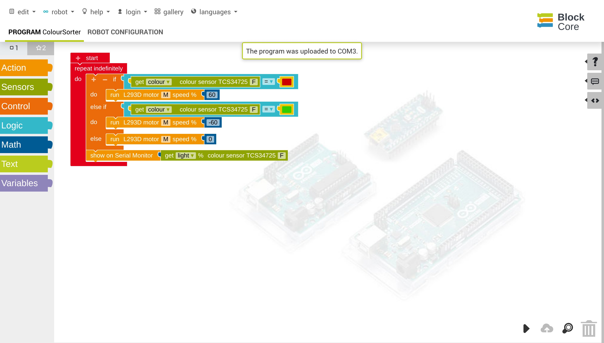
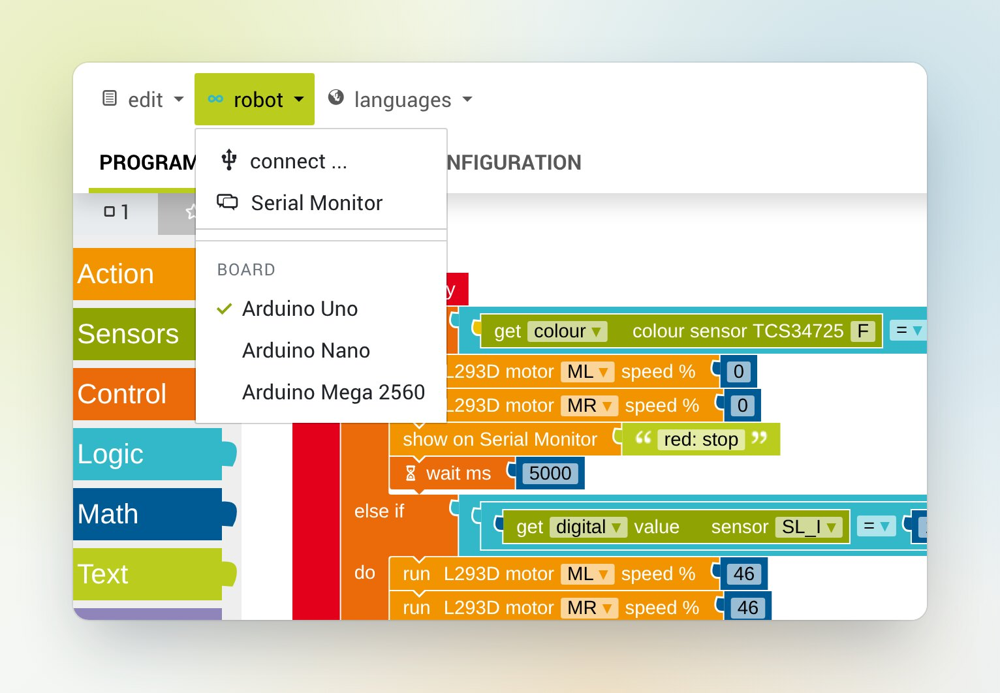
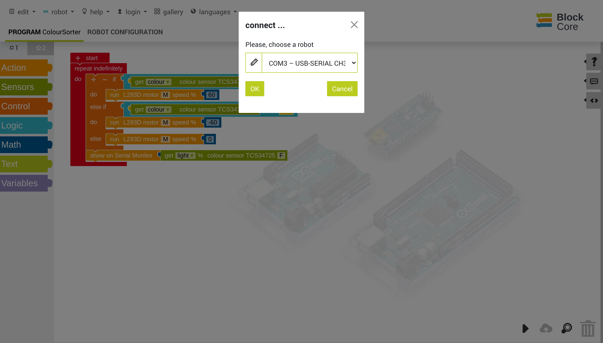
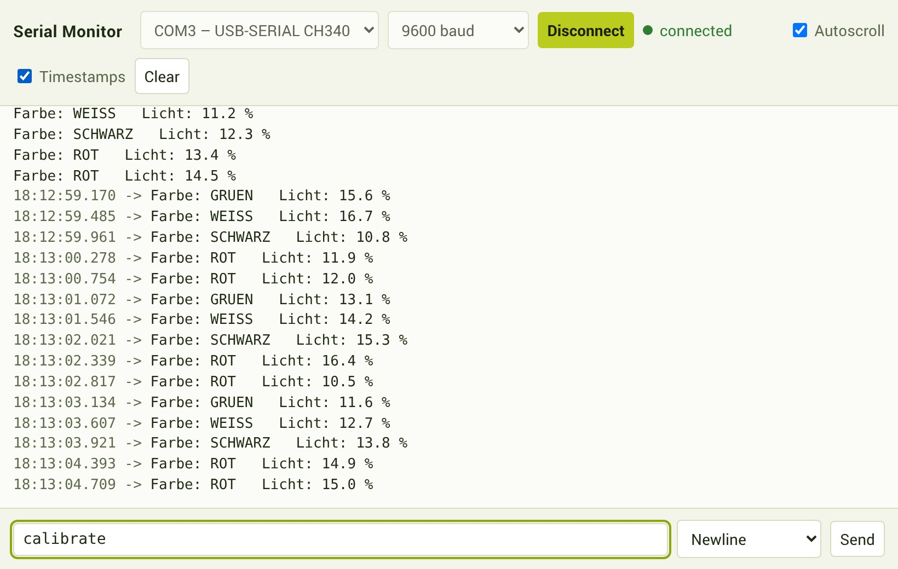
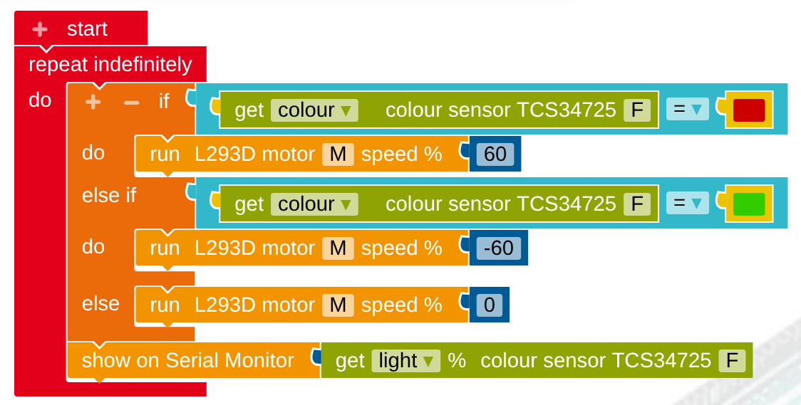
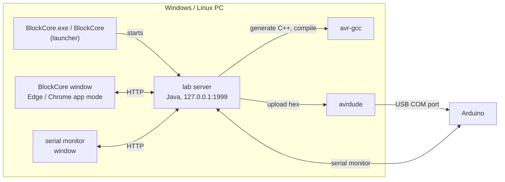

# BlockCore

[](LICENSE)
[](docs/LICENSE)
[](../../actions/workflows/windows_installer.yml)

**Offline block programming for Arduino on Windows and Linux: install it, plug in an Arduino, pick its port, snap blocks together and press ▶. Compiler, upload and serial monitor run on your own PC – no internet, no server, no connector app.**



BlockCore is a standalone edition of the [Open Roberta Lab](https://lab.open-roberta.org) by Fraunhofer IAIS. The online lab needs a server
and a separate connector program to reach the robot; BlockCore packs the whole lab, the AVR compiler and the uploader into one program
for Windows or Linux that opens in its own window. On top it adds blocks for the hardware we use in class: the **TCS34725 colour sensor** and the
**L293D motor shield**.

| | |
|---|---|
| **Boards** | Arduino Uno, Arduino Nano (new and old bootloader), Arduino Mega 2560 |
| **Runs on** | Windows 10 / 11 (64 bit) and Linux (x86_64: Ubuntu 22.04, Debian 12, Fedora 36, Mint 21 or newer), no admin rights needed; opens as its own window (no browser tabs, no console) |
| **Upload** | over the USB COM port with avrdude, port selected in the lab |
| **Serial monitor** | own window: baud rate, timestamps, autoscroll, send line; pauses itself during an upload |
| **Extra blocks** | TCS34725 colour sensor (red / green / white / black, light, RGB channels), MPU6050 gyro (tilt, rotation, acceleration), analog joystick, DS18B20 temperature probe, L293D motor shield (M1–M4) |
| **Look** | dark (default) or light theme, pictures of the parts on the configuration blocks, settings in *edit → Settings* |
| **Languages** | English (default) and German, switchable in the program |
| **Inside** | Open Roberta server with a trimmed Java 21 runtime, avr-gcc 7.3 (AVR5/AVR6 only), avrdude, Arduino AVR core |
| **Speed** | starts in about 1.5 s (class data archive), compiles in a fraction of a second (precompiled Arduino headers) |
| **Network** | the lab listens on `127.0.0.1` only; at start it asks GitHub once whether a newer version exists (silent when offline) |

## Download

All files are on the **[latest release](../../releases/latest)**.

**Windows: `BlockCore-Setup.exe`** (≈ 70 MB)

1. Run the installer. Windows SmartScreen warns about unsigned programs: **More info → Run anyway**.
2. It installs to `%LOCALAPPDATA%\Programs\BlockCore` and adds shortcuts to the desktop and the start menu.

No installation wanted? Unzip **`BlockCore-portable.zip`** from the same release (e.g. onto a USB stick) and start `BlockCore.exe`.

**Linux: `BlockCore-linux-x64.tar.gz`** (≈ 110 MB)

```bash
tar -xzf BlockCore-linux-x64.tar.gz
```

```bash
BlockCore/BlockCore --install
```

`--install` adds BlockCore to the application menu (no root needed); `BlockCore/BlockCore` starts it directly. The window is Chrome,
Chromium, Edge, Brave or Vivaldi in app mode (otherwise your default browser). For uploads your user must be in the group `dialout`
(Arch: `uucp`) once – BlockCore tells you if it is missing:

```bash
sudo usermod -aG dialout $USER
```

Then log out and in again. On Ubuntu with CH340 clones, remove `brltty` if no port shows up (`sudo apt remove brltty`).

Every push to `main` builds new packages and publishes them as a release
([Actions → Windows-Installer](../../actions/workflows/windows_installer.yml)).

## Getting started

1. Start **BlockCore**. A small start window appears for a few seconds, then the BlockCore window opens.
2. Plug in the Arduino.
3. **robot → connect** and pick the COM port. With a single Arduino attached it is selected automatically.
   The board (Uno, Nano, Mega) is chosen in the same menu:

   


   

4. Describe the hardware in **ROBOT CONFIGURATION** (sensors, motors …), build the program in **PROGRAM** and press **▶**.
   The program is compiled on your PC and uploaded; a panel at the top shows the progress and a check mark when it is on the Arduino.
5. **robot → Serial Monitor** shows what the Arduino prints with *show on Serial Monitor*.
6. Close the BlockCore window to quit; the server stops with it.

Programs are saved for a local user that BlockCore creates and logs in automatically – there is no login dialog. The language
(German / English) is switched in the **languages** menu and remembered.

A step-by-step guide for students is in **[docs/GUIDE.md](docs/GUIDE.md)**.

### Serial monitor



Works like the one in the Arduino IDE: choose port and baud rate (9600 by default), read the output with or without timestamps, send a
line with the chosen line ending. You do not have to close it before uploading: BlockCore pauses the monitor, uploads, and connects again.

### Settings

**edit → Settings** (or **Ctrl + ,**): theme dark / light / like Windows (dark by default), language, block size, grid, BlockCore logo in
the background, pictures of the parts in the configuration, block click sounds, board at start, select the last COM port again, upload
progress, default baud rate and timestamps of the serial monitor, update check and update channel. The settings are stored on this PC.

### Updates


The version is shown below the logo. When a newer release exists, a small note slides in at the bottom right. In an installed BlockCore
**Update now** downloads the installer, closes BlockCore, installs the update without questions and starts BlockCore again; the portable
version links to the download. Without internet nothing is shown. With the update channel **Beta** (settings) BlockCore also offers
pre-releases; they are built from the branch `next`.

## TCS34725 colour sensor



The block **get colour colour sensor TCS34725** returns **red, green, white or black** – compare it with the colour blocks. Anything it
cannot classify is returned as grey.

| Mode | Result |
|---|---|
| colour | red `#cc0000`, green `#33cc00`, white `#ffffff`, black `#000000`, grey = unknown |
| light | brightness (clear channel) in % |
| red / green / blue | share of the channel in the measured light, in % |

**Wiring (Uno / Nano):** VIN → 5V, GND → GND, SDA → **A4**, SCL → **A5**. On the Mega the I²C pins are 20 (SDA) and 21 (SCL), even though
the configuration block shows A4 / A5. A4 and A5 are the only I²C pins of the Uno, so the configuration reports an error if another part
uses them as normal pins (move e.g. an ultrasonic sensor to A0 / A1). I²C displays may share the bus.

**Calibration:** the configuration block has two thresholds, *black below %* and *white above %* (both 2.7 by default: tuned for the sensor without its LED, black measured up to 2.4 %, white 3.0 %; with a bright LED set them between your black and white values). Print *light*,
*red*, *green* and *blue* on the serial monitor, hold the sensor about 1 cm above each surface and set the thresholds between the values.
The colour mode decides in this order:

1. **white balance:** each channel is divided by its share on white paper (red 31 %, green 45 %, blue 39 % – the sensor sees much more
   green than red even on white)
2. balanced red > 1.06 × green and > 1.06 × blue → **red**
3. balanced green > 1.10 × red and > 1.025 × blue → **green** (green paper reflects much blue, too; black has too little red as well, but there green and blue are equal)
4. light below *black below %* → **black**
5. light above *white above %* → **white**
6. otherwise **grey**

Red and green are checked before black, because a coloured surface can be dark, too. The factors were tuned with 61 readings of a real
sensor (22 × green, 19 × red, 18 × black, 2 × white): all recognised.

The driver is a small header ([`TCS34725.h`](RobotArdu/src/main/resources/arduino/TCS34725/TCS34725.h), 154 ms integration time,
automatic gain 1× … 60×) and needs no Adafruit library. *light* keeps the scale of 4× gain and 50 ms, so the thresholds stay comparable.
The sensor needs light: the LED on the board must be on, about 1 cm distance, room light shaded. If *light* is below about 2 % on every
surface, the sensor reports black. Only one sensor is possible (fixed I²C address `0x29`).

## More sensors

| Block | Part | Values |
|---|---|---|
| **gyro sensor MPU6050** | GY-521 module, I²C (A4 / A5, shares the bus with the TCS34725) | tilt sideways / forwards in degrees, rotation x/y/z in °/s, acceleration x/y/z in g, temperature |
| **joystick** | analog joystick (KY-023): VRx, VRy at analog pins, SW at a digital pin | x and y in percent (−100 … 100), button pressed |
| **temperature sensor DS18B20** | 1-Wire probe (e.g. waterproof), 4.7 kΩ pull-up from data to VCC | temperature in °C, −127 without sensor |

The MPU6050 calibrates its gyro when the program starts: keep the robot still for half a second. Its tilt angles combine gyro and
acceleration sensor (complementary filter), so they follow fast movements and do not drift. The DS18B20 measures in the background:
reading it never blocks the program. Both drivers are small headers in `RobotArdu/src/main/resources/arduino` and need no library.

## L293D motor shield

For the first-generation Adafruit motor shield (L293D + 74HC595 shift register) and its clones. Add one **L293D motor** block per motor
(port M1–M4) to the configuration; **run L293D motor … speed %** takes −100 … 100 (negative = backwards, 0 = motor released).

### Pin map (Uno with shield, colour sensor and ultrasonic sensor)

| Pins | Used by |
|---|---|
| 0, 1 | USB serial (keep free) |
| 3, 5, 6, 11 | L293D PWM for M2, M4, M3, M1 |
| 4, 7, 8, 12 | L293D shift register (clock, enable, data, latch) |
| 9, 10 | servo connectors of the shield (servo 2, servo 1) |
| A4, A5 | I²C: TCS34725 (SDA, SCL) |
| **2, 13, A0–A3** | **free** – e.g. ultrasonic trig A0, echo A1 |

## How it works



- **`BlockCore.exe`** ([`launcher.c`](Resources/standalone/launcher.c)) on Windows and the script **`BlockCore`**
  ([`linux/BlockCore`](Resources/standalone/linux/BlockCore)) on Linux show a start window, create the database on the first start, start
  the server hidden with the bundled Java runtime and open the lab as an app window (Edge, Chrome or Chromium in app mode with a profile
  of its own, otherwise the default browser). Closing that window stops the server: the launcher closes the server's standard input, the
  server ends normally and Java stores the classes it loaded in a class data archive (`cds/blockcore.jsa` in the data folder). The next
  start maps that archive and is about 40 % faster.
- The package build adds [`blockcore.js`](Resources/standalone/branding/web/blockcore.js) to the lab: board selection in the robot
  menu instead of the start page, only English (default) and German, automatic login of a local user, settings with dark theme, pictures of
  the parts, undo / redo keys and the update display. Apart from the update check (GitHub, once per start) the lab contacts no other server.
- BlockCore contains only what an Arduino lab needs: the Open Roberta plugins of other robots, the simulation, the neural network, the robot
  connectors and the other languages are removed.
- The server runs in **local mode** (`server.local.serial=true`): it lists the COM ports (`/rest/local/ports`), compiles without a robot
  token, uploads with avrdude (`/rest/local/upload`) and runs the serial monitor (`/rest/local/monitor/*`). These services only answer
  requests from the same PC and from pages of this server.
- The AVR boards are compiled without bash: `ArduinoAvrDirectBuild` calls avr-g++, avr-gcc and avr-objcopy directly. Every generated
  program includes the Arduino core and the ArduinoSTL (over 2000 header files); after the first program of a board these headers are
  compiled once into a precompiled header (`blockcore-pch/` in the temporary folder), and every further program compiles in a fraction of
  the time – with byte for byte the same result. Uploads remember the baud rate that worked for a board and port (Nano with the old
  bootloader).
- On a normal, public lab server the local mode is off and everything works as in the original (token and connector).

## Repository layout

```
Resources/standalone/             build-windows.sh, build-linux.sh, common.sh, Windows launcher (C), NSIS installer, linux/ launcher, branding
.github/workflows/                windows_installer.yml builds and releases the Windows and Linux packages
OpenRobertaServer/                Lab server; local mode in javaServer/restServices/local/, serial monitor page staticResources/serial.html
OpenRobertaWeb/                   Frontend (TypeScript); LocalSerialOrTokenConnection in .../controller/connections/connections.ts
RobotArdu/                        Arduino plugin (Uno, Nano, Mega): blocks and drivers (TCS34725, MPU6050, DS18B20, L293D), direct AVR build
OpenRobertaRobot/                 Core of the lab: program and configuration model, code generation base
docs/                             Guide for students, images, CC BY 4.0 license of the documentation
```

## Building

On Linux (e.g. Ubuntu) with Java 11+, Maven, `python3`, `gcc-mingw-w64-x86-64`, `nsis`, `zip`, `unzip`, `curl` and `avrdude`:

```bash
mvn clean install -DskipTests
```

```bash
Resources/standalone/build-windows.sh target/standalone
```

```bash
Resources/standalone/build-linux.sh target/standalone
```

The result is `target/standalone/BlockCore-Setup.exe`, `BlockCore-portable.zip` and `BlockCore-linux-x64.tar.gz`. The scripts download
Temurin JDK 21 (for jlink), avr-gcc 7.3, avrdude 7.3 (Windows) and the Arduino resources from GitHub and only pack the AVR boards and the
Arduino libraries the code generator uses. The Linux package takes avrdude from the build system (Ubuntu package) together with the
libraries it needs. `Resources/standalone/collect-sources.sh` collects the source code of the GPL / LGPL software in the packages into
`BlockCore-third-party-sources.tar`, which every release contains. The frontend is built with
`npm ci && npx gulp` in `OpenRobertaWeb/`; the generated files in `OpenRobertaServer/staticResources/js` are checked in.

To run the local mode on Linux (avr-gcc and avrdude from the package manager, Arduino resources from
[ora-cc-rsc](https://github.com/OpenRoberta/ora-cc-rsc) under `<rsc>/RobotArdu/arduino-resources`), create the database once and start
the server:

```bash
java -cp "OpenRobertaServer/target/resources/*" de.fhg.iais.roberta.main.Administration create-empty-db jdbc:hsqldb:file:/tmp/ora-db/openroberta-db
```

```bash
java --add-opens java.base/java.lang=ALL-UNNAMED -cp "OpenRobertaServer/target/resources/*" de.fhg.iais.roberta.main.ServerStarter -d database.mode=embedded -d database.parentdir=/tmp/ora-db -d database.name=openroberta-db -d server.staticresources.dir=OpenRobertaServer/staticResources -d robot.crosscompiler.resourcebase=<rsc> -d server.ip=127.0.0.1 -d server.local.serial=true
```

### Test status

- Unit tests for the sensors, the configuration checks, the local mode, the serial monitor and the update; code generation tests of all
  common programs and of the Arduino programs (e.g. `uno/tcs34725_colour`, `uno/blockcore_sensors`) against expected C++ code.
- Complete flow in the browser (port selection, compile, upload, messages) for Uno, Nano and Mega on Linux with the files of the Windows
  package; serial monitor tested with a virtual serial port (receive incl. UTF-8, send, pause and resume around an upload).
- The colour sensor driver compiles against the Arduino AVR core and was tested with simulated readings.
- Linux package: launcher tested end to end (start, compile, window closed, normal stop, class data archive).
- **Still open:** a test of this version on a real Windows PC and of the Linux package on a desktop with a real Arduino.

## Changelog

| Version | Changes |
|---|---|
| 1.2 | **Linux version** (`BlockCore-linux-x64.tar.gz`). Faster: start about 40 % faster (class data archive), compiling about 4 × faster from the second program on (precompiled headers), Nano uploads with the old bootloader without the failing first attempt; packages smaller (Windows installer ≈ 70 MB instead of 83 MB) – unused Java libraries, Arduino libraries of other robots and compiler parts removed. Licences of all included software in `THIRD-PARTY-NOTICES.md` (also in the packages and under *edit → Settings → Licenses*) |
| 1.1 | Settings (edit → Settings) with dark theme (default), language, block size, grid, sounds, start board, serial monitor and update channel (stable / beta); new sensors MPU6050, analog joystick, DS18B20; pictures of the parts on the configuration blocks; ultrasonic sensor, TCS34725 and L293D motor also in the beginner toolbox; undo / redo with Ctrl+Z / Ctrl+Y; menus work after the window was small; everything that is not needed for the Arduino removed (other robots, simulation, neural network, connectors, other languages) |
| 1.0.15 – 1.0.19 | Versioned releases, version below the logo, update check and one-click update, upload panel with progress bar and check mark, USB symbol, COM port of the last upload is selected again, animated start window, BlockCore logo in the workspace, motor driver and colour sensor no longer slow down fast loops |
| Build 8–14 | Colour detection tuned with real sensor readings (red, green, white recognised), defaults *black below* / *white above* 2.7, black no longer mistaken for green. Fix for "avr-objcopy … .elf: No such file" when run was clicked twice |
| Build 6–7 | English by default, all texts in English. Colour sensor with automatic gain (154 ms, 1× … 60×) for dark surfaces. Launcher watches the BlockCore windows (no "click OK to quit" dialog) |
| Build 4 | No console: start window and app window, server stops with the window. Board selection in the robot menu, German / English only, automatic local login, no online requests. Ultrasonic sensor fixed (10 µs trigger instead of 10 ms, 30 ms timeout). Trimmed Java 21 runtime and AVR toolchain (smaller, faster start) |
| Build 3 | BlockCore name and logo, own app window, serial monitor |
| Build 2 | First Windows installer: local COM port upload, direct AVR build, TCS34725 and L293D blocks |

## License

© 2026 Marvin Ramm. Open source with attribution:

- Code: [Apache License 2.0](LICENSE), like the Open Roberta Lab it is based on
- Documentation, images and the BlockCore logo: [CC BY 4.0](docs/LICENSE)

Credit "BlockCore by Marvin Ramm" with a link to this repository. Details are in [LICENSING.md](LICENSING.md).

BlockCore is based on the [Open Roberta Lab](https://github.com/OpenRoberta/openroberta-lab) © Fraunhofer IAIS (via
[rosslight/openroberta-lab](https://github.com/rosslight/openroberta-lab), develop @ `40ef141`). "Roberta", "Open Roberta" and
"Open Roberta Lab" are trademarks of the Fraunhofer Society; BlockCore is not an official Fraunhofer product and uses its own name and
logo, as the [NOTICE](NOTICE) requires for modified versions. The packages also contain Eclipse Temurin (GPLv2 with Classpath
Exception), avr-gcc / avr-libc (GPL / modified BSD), avrdude (GPLv2) and the Arduino core (LGPL); all included software and its licence is
listed in [THIRD-PARTY-NOTICES.md](THIRD-PARTY-NOTICES.md).
