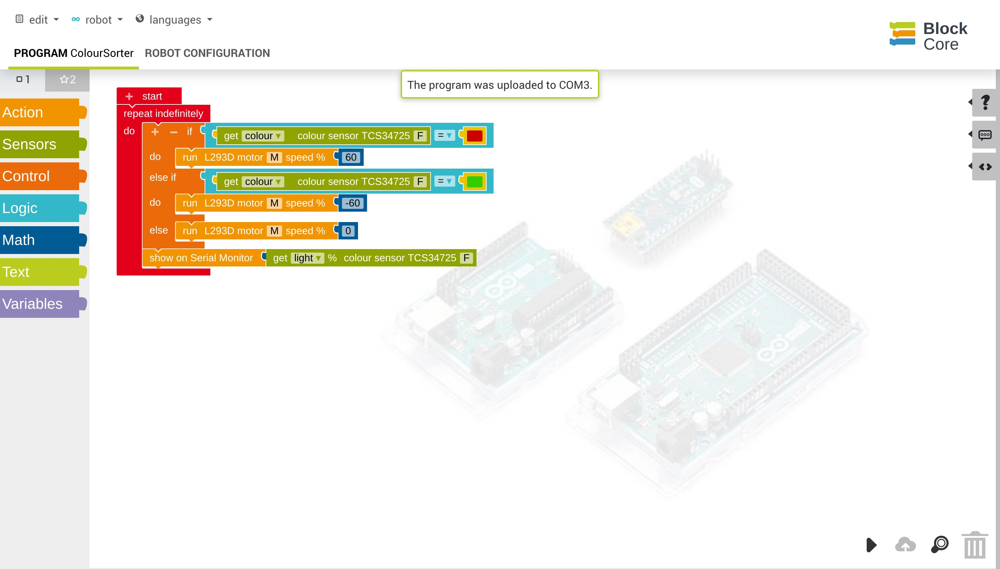
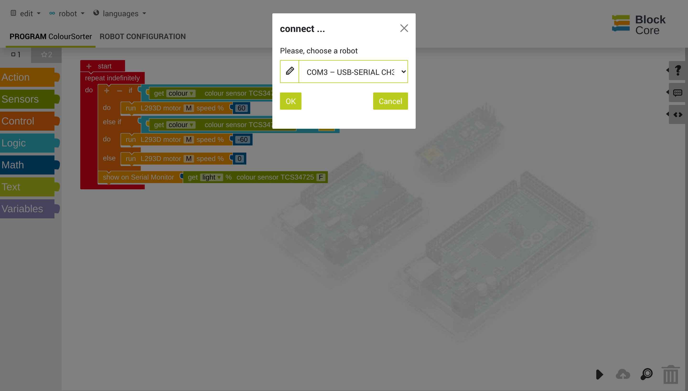
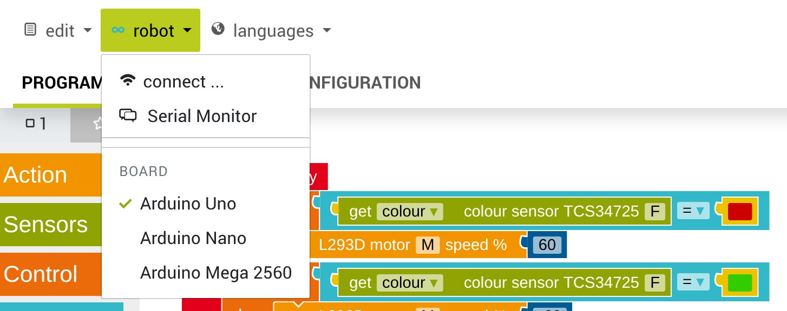
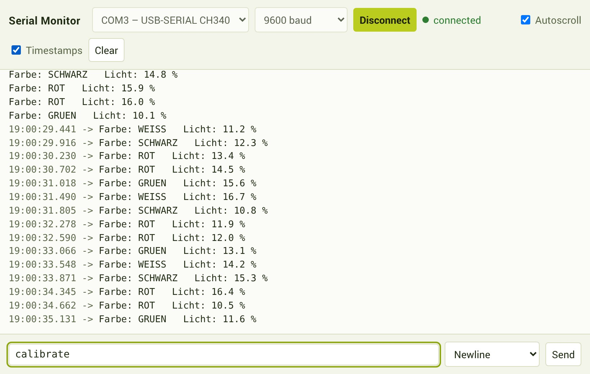
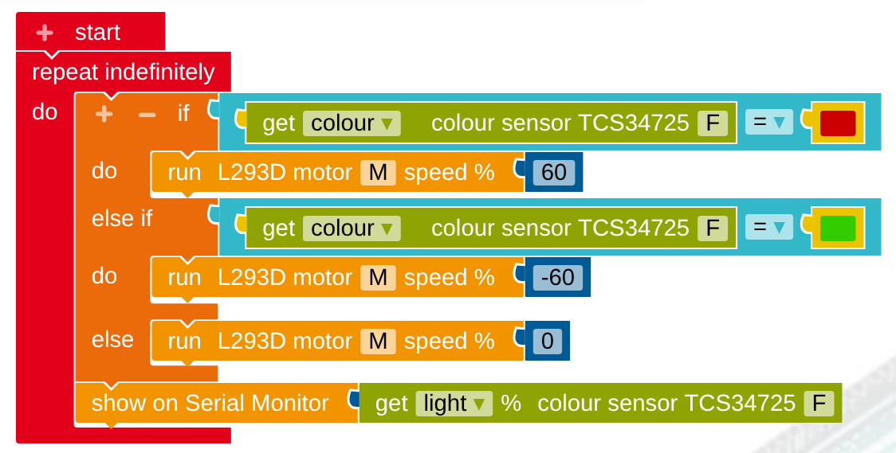

# BlockCore – Anleitung

BlockCore ist eine Blockprogrammierung für den Arduino, die komplett auf deinem Windows-PC läuft. Du brauchst kein Internet und kein
Zusatzprogramm: Arduino anstecken, Blöcke zusammenstecken, ▶ drücken.

## Installieren

1. Unter **[Releases](../../../releases/latest)** die Datei **`BlockCore-Setup.exe`** herunterladen.
2. Setup starten. Warnt Windows („Der Computer wurde durch Windows geschützt“): **Weitere Informationen → Trotzdem ausführen**.
3. Fertig – auf dem Desktop und im Startmenü gibt es jetzt **BlockCore**. Admin-Rechte sind nicht nötig.

Ohne Installation: `BlockCore-portable.zip` entpacken und `BlockCore.exe` starten.

## Loslegen

1. **BlockCore** starten. Ein kleines Startfenster zeigt kurz „wird gestartet …“, danach öffnet sich das BlockCore-Fenster.
2. Den Arduino per USB anschließen.
3. **Roboter → Verbinden** und den COM-Port wählen, z. B. `COM3 – USB-SERIAL CH340`. Ist nur ein Arduino angeschlossen, wird er
   automatisch gewählt und das Roboter-Symbol oben wird grün.

   

4. Unter **Roboterkonfiguration** eintragen, was am Arduino hängt (Sensoren, Motoren …).
5. Unter **Programm** die Blöcke zusammenstecken und auf **▶** klicken. Das Programm wird übersetzt und auf den Arduino geladen.
   Oben erscheint „Das Programm wurde auf COM3 übertragen“.
6. Zum Beenden einfach das **BlockCore-Fenster** schließen.

Das Board (Uno, Nano, Mega) wählst du im Menü **Roboter** unter **Board**:

Die Sprache (Deutsch / Englisch) stellst du im Menü **Sprachen** um. Programme speichert BlockCore automatisch für deinen PC –
ein Benutzerkonto brauchst du nicht.

## Serieller Monitor

Mit dem Block **zeige auf Serial Monitor** schickt der Arduino Text an den PC. Du siehst ihn unter **Roboter → Serieller Monitor** in
einem eigenen Fenster.

- Port und Baudrate wählen (Standard 9600) und **Verbinden** klicken.
- **Zeitstempel** zeigt, wann jede Zeile ankam, **Autoscroll** springt immer zur neuesten Zeile.
- Unten kannst du Text an den Arduino **senden**.
- Du musst den Monitor vor dem Hochladen nicht schließen: Er pausiert automatisch und verbindet sich danach wieder.

## Farbsensor TCS34725

| TCS34725 | Arduino Uno / Nano | Arduino Mega |
|---|---|---|
| VIN | 5V | 5V |
| GND | GND | GND |
| SDA | **A4** | 20 |
| SCL | **A5** | 21 |

In der **Roboterkonfiguration** den Block **Farbsensor TCS34725** einfügen. Im Programm liefert **gib Farbe Farbsensor F** die erkannte
Farbe: Rot, Grün, Weiß oder Schwarz (Grau = nicht erkannt). Vergleiche sie mit den Farbblöcken aus der Kategorie **Farben**:

**Kalibrieren:** Gib mit dem Block **zeige auf Serial Monitor** die Werte *Licht*, *rot*, *grün* und *blau* aus, halte den Sensor ca. 1 cm
über Schwarz, Weiß, Rot und Grün und schau im seriellen Monitor nach. Dann im Konfigurationsblock **Schwarz unter %** knapp über den
Schwarz-Wert und **Weiß über %** knapp unter den Weiß-Wert setzen.

A4 und A5 dürfen nicht von anderen Bauteilen belegt sein. Einen Ultraschallsensor also z. B. auf **A0 / A1** stecken.

## Motor-Shield L293D

In der **Roboterkonfiguration** pro Motor einen Block **L293D motor** mit Port **M1–M4** anlegen. Im Programm dreht
**run L293D motor … speed %** den Motor: −100 bis 100, negativ = rückwärts, 0 = aus.

Freie Pins mit Shield: **2, 13, A0–A3** (A4 / A5 für den Farbsensor).

## Hilfe

| Problem | Lösung |
|---|---|
| Kein COM-Port in der Liste | Anderes USB-Kabel probieren (manche laden nur). Viele Nachbauten brauchen den Treiber **CH340** („CH340 Treiber Windows“ suchen). |
| Übertragung fehlgeschlagen | Richtigen COM-Port gewählt? Benutzt ein anderes Programm (z. B. die Arduino IDE) den Port? Noch einmal ▶ drücken. |
| Fehler in der Konfiguration bei A4 / A5 | Ein anderes Bauteil steckt auf A4 / A5 – auf A0–A3 umstecken. |
| Farbsensor meldet immer Grau | Kalibrieren (siehe oben), ca. 1 cm Abstand, die LED am Sensor muss leuchten. |
| BlockCore-Fenster geht nicht auf | Selbst im Browser <http://127.0.0.1:1999> öffnen. |
| Ultraschallsensor zeigt immer 0 | Trig und Echo richtig herum angeschlossen? VCC an 5V? Nicht auf A4 / A5 stecken, wenn ein Farbsensor dran ist. |
| Sonstiger Fehler | In `%LOCALAPPDATA%\BlockCore\logs\server.log` steht, was passiert ist. |

Deine Programme liegen in `%LOCALAPPDATA%\BlockCore`. Beim Deinstallieren (Einstellungen → Apps → BlockCore) bleiben sie erhalten.
