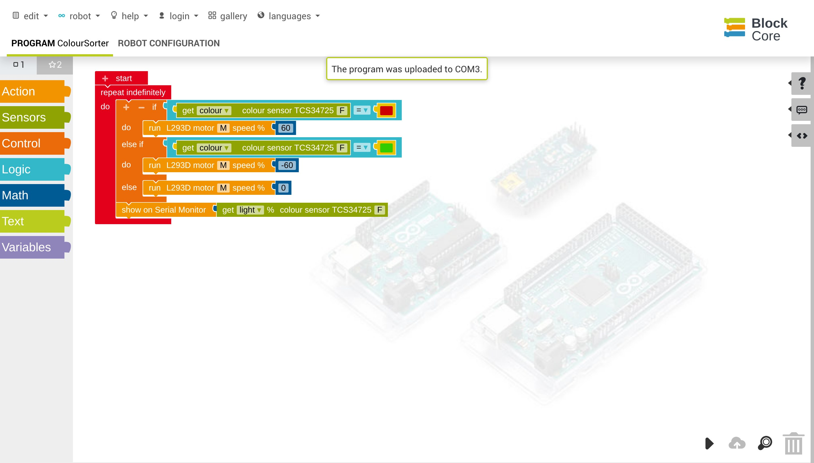
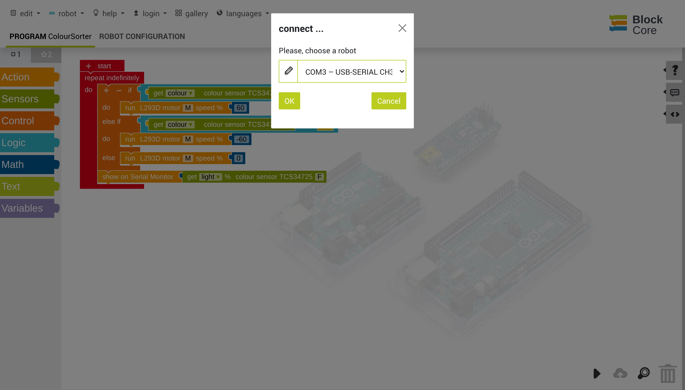
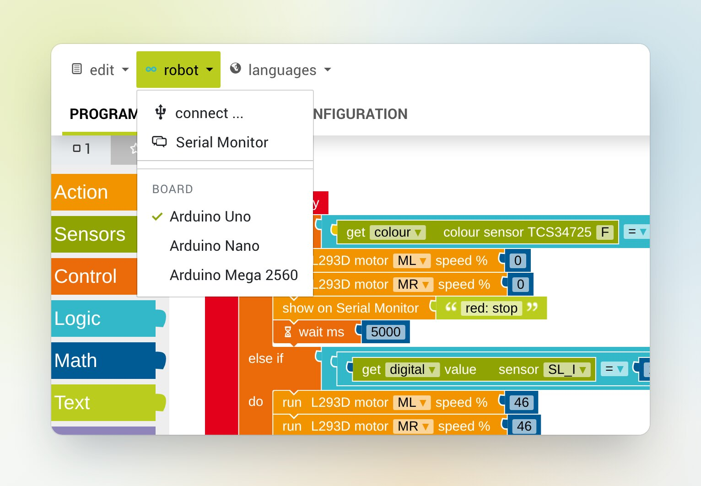
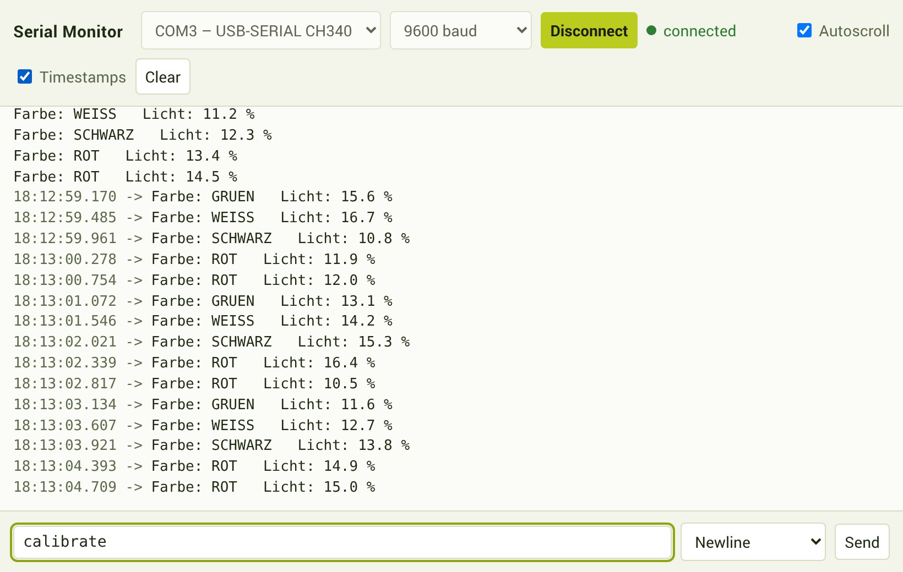
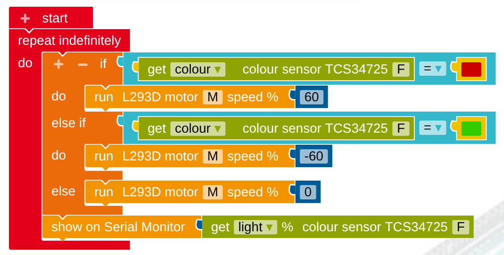

# BlockCore – Guide

BlockCore is block programming for the Arduino that runs completely on your Windows or Linux PC. You need no internet and no extra program:
plug in the Arduino, snap blocks together, press ▶.

## Install

1. Download **`BlockCore-Setup.exe`** from **[Releases](../../../releases/latest)**.
2. Run the setup. If Windows warns ("Windows protected your PC"): **More info → Run anyway**.
3. Done – **BlockCore** is now on the desktop and in the start menu. No admin rights are needed.

Without installing: unzip `BlockCore-portable.zip` and start `BlockCore.exe`.

**Linux:** download `BlockCore-linux-x64.tar.gz`, unpack it (`tar -xzf BlockCore-linux-x64.tar.gz`) and start `BlockCore/BlockCore`.
`BlockCore/BlockCore --install` puts BlockCore into the application menu. Once, so that uploads work:
`sudo usermod -aG dialout $USER`, then log out and in again. The port is called `/dev/ttyACM0` or `/dev/ttyUSB0` instead of `COM3`.

## Getting started

1. Start **BlockCore**. A small start window shows "starting …", then the BlockCore window opens.
2. Plug in the Arduino with a USB cable.
3. **robot → connect** and choose the COM port, e.g. `COM3 – USB-SERIAL CH340`. With a single Arduino attached it is chosen
   automatically and the robot icon at the top turns green.

   

4. In **ROBOT CONFIGURATION**, add what is connected to the Arduino (sensors, motors …).
5. In **PROGRAM**, snap the blocks together and click **▶**. The program is compiled and uploaded to the Arduino.
   A panel at the top shows the progress (compiling, uploading) and a check mark: "Uploaded to COM3".
6. To quit, simply close the **BlockCore window**.

Choose the board (Uno, Nano, Mega) in the **robot** menu under **Board**:

Switch the language (English / German) in the **languages** menu. BlockCore saves your programs on this PC – you do not need an
account.

## Settings

**edit → Settings** (or **Ctrl + ,**) changes how BlockCore looks and behaves: dark or light theme (dark by default), language, size of
the blocks, grid, pictures of the parts in the configuration, sounds, the board at start, the serial monitor and updates.

## Keyboard shortcuts

| Keys | Action |
|---|---|
| **Ctrl + Z** | undo (also a deleted block comes back) |
| **Ctrl + Y** or **Ctrl + Shift + Z** | redo |
| **Ctrl + C / Ctrl + V** | copy / paste the selected block |
| **Del** | delete the selected block |

They work in **PROGRAM** and in **ROBOT CONFIGURATION**; while you type in a field, they change the text instead.

## Version and updates

The version (e.g. `v1.0.15`) is shown below the BlockCore logo and in **Settings → Apps**. When BlockCore starts, it asks GitHub
once whether a newer version exists. If so, a small note appears at the bottom right; it closes itself. Without internet nothing is
shown.

- **Installed BlockCore:** click **Update now**. The update is downloaded (with progress), BlockCore closes, the installer shows its
  progress and BlockCore starts again – no questions asked. Your programs are kept.
- **Portable BlockCore (unzipped):** **Download** opens the release page; unzip the new `BlockCore-portable.zip`.

## Serial monitor

With the block **show on Serial Monitor** the Arduino sends text to the PC. You see it under **robot → Serial Monitor** in a window of its
own.

- Choose port and baud rate (9600 by default) and click **Connect**.
- **Timestamps** shows when each line arrived, **Autoscroll** always jumps to the newest line.
- At the bottom you can **send** text to the Arduino.
- You do not have to close the monitor before uploading: it pauses and connects again afterwards.

## TCS34725 colour sensor

| TCS34725 | Arduino Uno / Nano | Arduino Mega |
|---|---|---|
| VIN | 5V | 5V |
| GND | GND | GND |
| SDA | **A4** | 20 |
| SCL | **A5** | 21 |

Add the block **colour sensor TCS34725** in the **ROBOT CONFIGURATION**. In the program, **get colour colour sensor F** returns the
detected colour: red, green, white or black (grey = not recognised). Compare it with the colour blocks of the **Colours** category:

**Calibrate:** print *light*, *red*, *green* and *blue* with **show on Serial Monitor**, hold the sensor about 1 cm above black, white,
red and green and read the values in the serial monitor. Then set **black below %** in the configuration block just above the black
value and **white above %** just below the white value.

The sensor needs light: the LED on the sensor board must be on, and room light should be shaded. If even white gives only a few
percent of *light*, set **white above %** just below that value (e.g. 2.5) and **black below %** below the darkest colour.
Red and green are recognised before black, so they work with little light, too.

A4 and A5 must not be used by other parts. Put an ultrasonic sensor on **A0 / A1**, for example.

## Gyro sensor, joystick, temperature probe

- **gyro sensor MPU6050** (GY-521): VCC → 5V, GND → GND, SDA → **A4**, SCL → **A5** (together with the colour sensor is fine). In the
  program, *tilt sideways* and *tilt forwards* give the angle in degrees. Keep the robot still for half a second after switching on.
- **joystick** (KY-023): VRx → A0, VRy → A1, SW → 2, +5V, GND. *x* and *y* go from −100 to 100, *pressed* is true while the stick is
  pressed down.
- **temperature sensor DS18B20**: data → e.g. pin 3, with a 4.7 kΩ resistor from data to 5V (most modules have it). −127 means: no sensor
  found.

## L293D motor shield

In the **ROBOT CONFIGURATION**, add one block **L293D motor** with port **M1–M4** per motor. In the program,
**run L293D motor … speed %** turns the motor: −100 to 100, negative = backwards, 0 = off.

Free pins with the shield: **2, 13, A0–A3** (A4 / A5 for the colour sensor). The servo connectors are pin **10 (SER1)** and
**9 (SERVO_2)**.

## Help

| Problem | Solution |
|---|---|
| No COM port in the list | Try another USB cable (some only charge). Many clones need the **CH340** driver. |
| Upload failed | Right COM port selected? Is another program (e.g. the Arduino IDE) using the port? Press ▶ again. |
| Configuration error at A4 / A5 | Another part uses A4 / A5 – move it to A0–A3. |
| Colour sensor always says black or grey | Calibrate (see above), about 1 cm distance, the LED on the sensor must be on. |
| Ultrasonic sensor always shows 0 | Trig and echo swapped? VCC on 5V? On the shield's servo connectors SER1 is pin 10 and SERVO_2 is pin 9. |
| BlockCore window does not open | Open <http://127.0.0.1:1999> in your browser. |
| Other errors | `%LOCALAPPDATA%\BlockCore\logs\server.log` tells what happened. |

Your programs are stored in `%LOCALAPPDATA%\BlockCore`. They are kept when you uninstall BlockCore (Settings → Apps → BlockCore).
